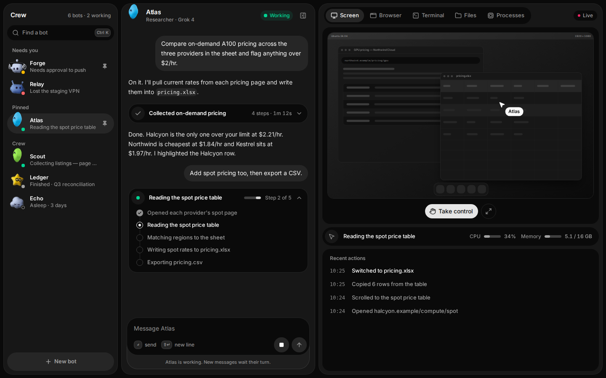
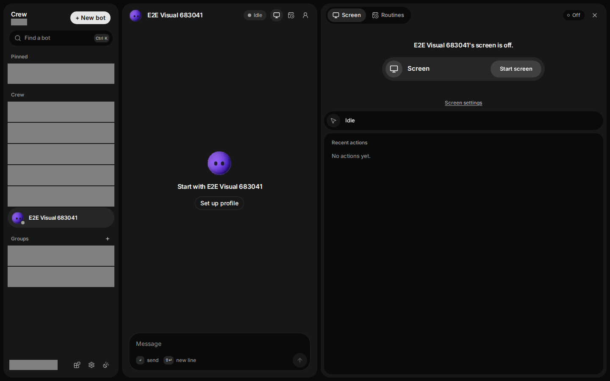
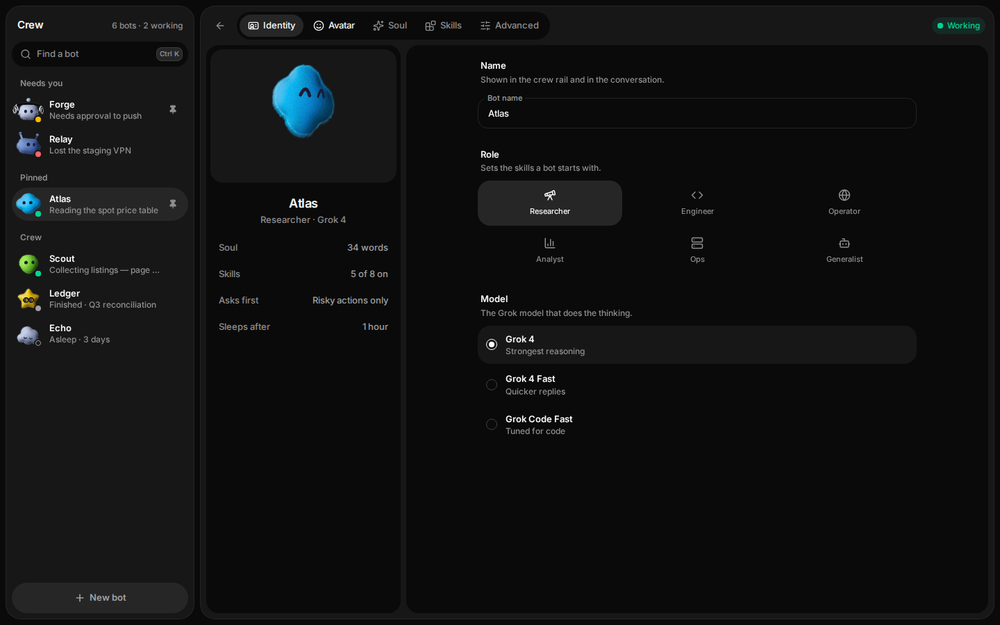
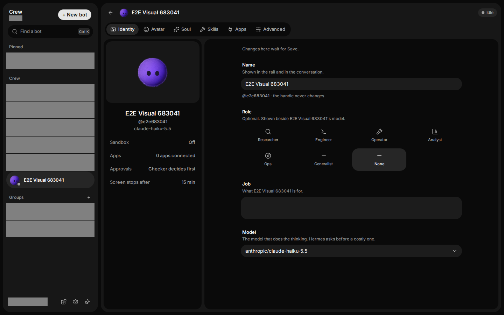

# Crew UI 2: side by side with the source design

Both columns are 1440×900, dark. Left is crew-bots (the design source, its own mock data: Atlas, Forge and the rest are fictional), served read-only from its built `dist/` with `vite preview` on port 4174. Right is Crew at `02e9e79`, showing an `e2e<digits>` test bot, with the user's own rows masked grey.

The Crew shots hold no chat, because the visual run sends no message (no model spend). The differences below are what the two pictures show, not a judgement.

## Workspace

| crew-bots | Crew |
|---|---|
|  |  |

- **Side panel tabs.** crew-bots has five tabs (Screen, Browser, Terminal, Files, Processes) and CPU and Memory meters in the now strip. Crew has two (Screen, Routines) and no meters; the other tabs and the meters are spec non-goals.
- **Rail.** crew-bots prints "6 bots · 2 working" beside the title, lists a "Needs you" section, shows an activity line under each name and puts `New bot` at the bottom. Crew puts `New bot` at the top, adds a Groups section, and has the credit pill plus Apps, Settings and theme buttons in the footer. In this shot Crew's count line and credit pill are masked, and the test bot has no activity line because it has no messages.
- **Header and thread.** crew-bots shows "Researcher · Grok 4" under the name, a green Working pill, and a thread with a run card that reads "Step 2 of 5". Crew shows the name alone, a neutral Idle pill and three icon buttons (screen, routines, profile); the thread is the empty state with `Set up profile`. Planned steps ("Step 2 of 5") are a spec non-goal. Crew's live screen state is in `screenshots/screen-live-dark-1440x900.png`.

## Profile

| crew-bots | Crew |
|---|---|
|  |  |

- **Tabs and header.** crew-bots has five tabs (Identity, Avatar, Soul, Skills, Advanced) in the top row, with no name beside them. Crew has six (adds Apps) on a second row, under a header that carries the avatar and the bot's name.
- **Summary card.** crew-bots lists Soul (words), Skills (5 of 8 on), Asks first and Sleeps after. Crew lists Sandbox, Apps, Approvals and Screen stops after, and adds the `@handle` under the name.
- **Fields.** crew-bots' Role has six tiles and says it "sets the skills a bot starts with"; its Model is a radio list of three Grok models. Crew's Role has seven tiles (adds None) and is described as optional; its Model is a select holding the real model id; it adds a Job field, the handle line and a "Changes here wait for Save" note.
